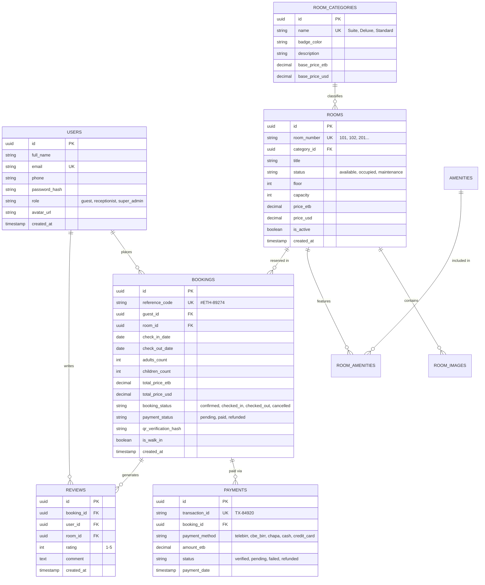

# SOFTWARE REQUIREMENTS SPECIFICATION (SRS)
## Luxury Ethiopian Hotel Management & Guest Booking System ("Kuriftu / Semien Grand Palace PMS & Engine")

**Document Version:** 2.0.0  
**Standard Compliance:** ISO/IEC/IEEE 29148:2018 & IEEE Std 830-1998  
**Author:** Lead Solutions Architect & Senior Full-Stack Engineer  
**Status:** Approved for Implementation  
**Target Environment:** Node.js / TypeScript, PostgreSQL, React / Next.js / Vue, Tailwind CSS  

---

## 1. INTRODUCTION

### 1.1 Purpose
This document provides the complete, production-grade Software Requirements Specification (SRS) for the **Luxury Ethiopian Hotel Management & Guest Booking System**. It incorporates all 9 core UI/UX subsystems across Guest, Front-Desk, and Executive Admin personas. Every visual component, transactional state machine, operational workflow, and analytical calculation is backed dynamically by a relational database schema (PostgreSQL) with zero hardcoded values.

### 1.2 System Overview & 9 Core Subsystems
The platform covers the entire hotel operational lifecycle:

1. **Guest Discovery & Room Catalog:** Real-time search, category filtering (`Suite`, `Deluxe`, `Standard`), wishlist favorites.
2. **Interactive Availability & Booking Calendar:** Real-time date-range calendar picker, booked-date locks, automatic price calculation, multi-currency display (ETB & USD).
3. **Room Details Showcase:** High-resolution image gallery viewer, amenity matrix, verified guest reviews and ratings.
4. **Authentication & Identity Management:** Dual Sign In / Registration with Ethiopian phone prefix (`+251`), email, password visibility toggle, and JWT issuance.
5. **Guest Self-Service ("My Bookings") & Digital Receipt:** Active/past bookings list, reservation modification/cancellation, digital receipt flyout with unique reference `#ETH-89274`, cryptographic check-in QR code, and PDF download.
6. **Executive Admin Dashboard:** Real-time KPI cards (Occupancy %, Active Bookings, Check-ins, Revenue), interactive color-coded Room Status Grid (Available: Green, Occupied: Gold, Maintenance: Grey), and recent guest reservations.
7. **Manage Hotel Rooms (Inventory CRUD):** Tabular room management with categories, live prices, status badges, and an integrated "Add / Edit Room" panel with amenity checkboxes and image upload.
8. **Front-Desk Check-In / Check-Out Operations Desk:** Front-desk console with Arriving/Departing/Active guest filters, Walk-In booking trigger, 1-click Check-In and Check-Out with invoice generation, reference search, and live QR Code check-in scanner.
9. **Payments & Transactions Management:** Multi-channel gateway management tracking Ethiopian payment channels (**Telebirr 42%**, **CBE Birr 31%**, **Chapa Gateway 18%**, and **Cash**), status verification (`Verified` vs `Pending`), and receipt printing.
10. **Financial & Occupancy Analytics & Reporting:** Monthly/Annual toggle, dual-metric revenue vs occupancy bar charts, room category donut charts, monthly financial summary tables, and PDF/Excel data export.

### 1.3 Design System & Cultural Identity
- **Primary Color:** Deep Ethiopian Forest Green / Emerald (`#0B4D34`, `#064E3B`, `#107550`).
- **Accent Color:** Warm Ethiopian Gold / Ochre (`#D4A329`, `#C59B27`, `#E0AC34`).
- **Cultural Motif:** Authentic Ethiopian woven textile embroidery ("Tibeb") ornamental border header banner rendered cleanly via vector SVG patterns.
- **Surface Elevation:** Crisp white card containers (`#FFFFFF`) with subtle soft shadows, 12px–16px border radiuses, and high-contrast typography.
- **Localization:** Native support for Ethiopian Birr (ETB) with USD toggle, Ethiopian phone formatting (`+251 9XX XXXXXX`), and Amharic / English localization readiness.

---

## 2. STAKEHOLDERS & USER ROLES (RBAC)

| Role | Persona | Permissions & Scope |
| :--- | :--- | :--- |
| **Guest** | Registered / Unregistered Visitor | Browse catalog, check dates, book rooms, select payment method (Telebirr/CBE/Chapa/Card), view digital QR receipt, download PDF, leave reviews, manage bookings. |
| **Front Desk Receptionist** | Front Desk Staff | Access Check-In/Out Desk, scan guest QR codes for instant verification, manage walk-in guests, execute 1-click Check-In and Check-Out with invoices, view room status matrix. |
| **Hotel General Manager / Admin** | Hotel Executive | Full system access: Room CRUD (Add/Edit rooms, pricing, amenities, photos), manage all transactions, verify pending payments, view financial & occupancy analytics, export reports. |
| **Housekeeping & Maintenance** | Service Staff | View and toggle room maintenance states (`available`, `occupied`, `maintenance`). |

---

## 3. COMPLETE DATABASE SCHEMA (POSTGRESQL DDL)

Zero hardcoded data: all rooms, rates, amenities, bookings, payments, reviews, and logs are persisted in a normalized relational database.



### Complete SQL DDL Script

```sql
-- Core Extensions
CREATE EXTENSION IF NOT EXISTS "uuid-ossp";
CREATE EXTENSION IF NOT EXISTS "pgcrypto";

-- Enums
CREATE TYPE user_role AS ENUM ('super_admin', 'receptionist', 'guest');
CREATE TYPE room_status AS ENUM ('available', 'occupied', 'maintenance');
CREATE TYPE booking_status AS ENUM ('confirmed', 'checked_in', 'checked_out', 'cancelled');
CREATE TYPE payment_gateway AS ENUM ('telebirr', 'cbe_birr', 'chapa', 'cash', 'credit_card');
CREATE TYPE payment_state AS ENUM ('verified', 'pending', 'failed', 'refunded');

-- 1. Users & Accounts
CREATE TABLE users (
    id UUID PRIMARY KEY DEFAULT gen_random_uuid(),
    role user_role NOT NULL DEFAULT 'guest',
    full_name VARCHAR(120) NOT NULL,
    email VARCHAR(160) UNIQUE NOT NULL,
    phone VARCHAR(30) NOT NULL, -- Format: +251 9XX XXXXXX
    password_hash VARCHAR(255) NOT NULL,
    avatar_url VARCHAR(500) DEFAULT '/avatars/default.png',
    created_at TIMESTAMP WITH TIME ZONE DEFAULT CURRENT_TIMESTAMP,
    updated_at TIMESTAMP WITH TIME ZONE DEFAULT CURRENT_TIMESTAMP
);

-- 2. Room Categories
CREATE TABLE room_categories (
    id UUID PRIMARY KEY DEFAULT gen_random_uuid(),
    name VARCHAR(50) UNIQUE NOT NULL, -- 'Suite', 'Deluxe', 'Standard'
    slug VARCHAR(60) UNIQUE NOT NULL,
    badge_color VARCHAR(30) DEFAULT '#0B4D34',
    description TEXT,
    base_price_etb NUMERIC(12, 2) NOT NULL,
    base_price_usd NUMERIC(10, 2) NOT NULL,
    created_at TIMESTAMP WITH TIME ZONE DEFAULT CURRENT_TIMESTAMP
);

-- 3. Rooms Inventory
CREATE TABLE rooms (
    id UUID PRIMARY KEY DEFAULT gen_random_uuid(),
    room_number VARCHAR(20) UNIQUE NOT NULL, -- '101', '102', '201', '301'...
    category_id UUID NOT NULL REFERENCES room_categories(id) ON DELETE RESTRICT,
    title VARCHAR(150) NOT NULL, -- 'Executive Ethiopian Suite'
    status room_status NOT NULL DEFAULT 'available',
    floor INT NOT NULL DEFAULT 1,
    capacity INT NOT NULL DEFAULT 2,
    price_etb NUMERIC(12, 2) NOT NULL,
    price_usd NUMERIC(10, 2) NOT NULL,
    is_active BOOLEAN NOT NULL DEFAULT TRUE,
    created_at TIMESTAMP WITH TIME ZONE DEFAULT CURRENT_TIMESTAMP,
    updated_at TIMESTAMP WITH TIME ZONE DEFAULT CURRENT_TIMESTAMP
);

-- 4. Room Media Gallery
CREATE TABLE room_images (
    id UUID PRIMARY KEY DEFAULT gen_random_uuid(),
    room_id UUID NOT NULL REFERENCES rooms(id) ON DELETE CASCADE,
    image_url VARCHAR(500) NOT NULL,
    caption VARCHAR(100),
    is_primary BOOLEAN NOT NULL DEFAULT FALSE,
    display_order INT NOT NULL DEFAULT 0
);

-- 5. Amenities & Junction
CREATE TABLE amenities (
    id UUID PRIMARY KEY DEFAULT gen_random_uuid(),
    name VARCHAR(80) UNIQUE NOT NULL, -- 'Wi-Fi', 'Breakfast', 'Spa', 'Airport Shuttle'
    icon_name VARCHAR(50) NOT NULL
);

CREATE TABLE room_amenities (
    room_id UUID NOT NULL REFERENCES rooms(id) ON DELETE CASCADE,
    amenity_id UUID NOT NULL REFERENCES amenities(id) ON DELETE CASCADE,
    PRIMARY KEY (room_id, amenity_id)
);

-- 6. Bookings & Reservations
CREATE TABLE bookings (
    id UUID PRIMARY KEY DEFAULT gen_random_uuid(),
    reference_code VARCHAR(30) UNIQUE NOT NULL, -- '#ETH-89274'
    guest_id UUID NOT NULL REFERENCES users(id) ON DELETE RESTRICT,
    room_id UUID NOT NULL REFERENCES rooms(id) ON DELETE RESTRICT,
    check_in_date DATE NOT NULL,
    check_out_date DATE NOT NULL,
    adults_count INT NOT NULL DEFAULT 1,
    children_count INT NOT NULL DEFAULT 0,
    total_price_etb NUMERIC(12, 2) NOT NULL,
    total_price_usd NUMERIC(10, 2) NOT NULL,
    booking_status booking_status NOT NULL DEFAULT 'confirmed',
    is_walk_in BOOLEAN NOT NULL DEFAULT FALSE,
    qr_verification_hash VARCHAR(255) NOT NULL,
    notes TEXT,
    created_at TIMESTAMP WITH TIME ZONE DEFAULT CURRENT_TIMESTAMP,
    updated_at TIMESTAMP WITH TIME ZONE DEFAULT CURRENT_TIMESTAMP,
    CONSTRAINT check_dates CHECK (check_out_date > check_in_date)
);

-- 7. Payment Transactions
CREATE TABLE payments (
    id UUID PRIMARY KEY DEFAULT gen_random_uuid(),
    transaction_id VARCHAR(50) UNIQUE NOT NULL, -- 'TX-84920'
    booking_id UUID NOT NULL REFERENCES bookings(id) ON DELETE RESTRICT,
    payment_method payment_gateway NOT NULL,
    amount_etb NUMERIC(12, 2) NOT NULL,
    amount_usd NUMERIC(10, 2),
    status payment_state NOT NULL DEFAULT 'verified',
    payment_date TIMESTAMP WITH TIME ZONE DEFAULT CURRENT_TIMESTAMP
);

-- 8. Verified Guest Reviews
CREATE TABLE reviews (
    id UUID PRIMARY KEY DEFAULT gen_random_uuid(),
    booking_id UUID UNIQUE NOT NULL REFERENCES bookings(id) ON DELETE CASCADE,
    guest_id UUID NOT NULL REFERENCES users(id) ON DELETE CASCADE,
    room_id UUID NOT NULL REFERENCES rooms(id) ON DELETE CASCADE,
    rating INT NOT NULL CHECK (rating >= 1 AND rating <= 5),
    comment TEXT NOT NULL,
    created_at TIMESTAMP WITH TIME ZONE DEFAULT CURRENT_TIMESTAMP
);

-- Indices for rapid querying & concurrency locking
CREATE INDEX idx_bookings_dates ON bookings (room_id, check_in_date, check_out_date);
CREATE INDEX idx_bookings_status ON bookings (booking_status);
CREATE INDEX idx_bookings_guest ON bookings (guest_id);
CREATE INDEX idx_rooms_status ON rooms (status);
CREATE INDEX idx_payments_method ON payments (payment_method);
CREATE INDEX idx_payments_status ON payments (status);
```

---

## 4. DETAILED UI/UX SPECIFICATIONS (ALL 9 SUBSYSTEMS)

### 4.1 Screen 1: Financial & Occupancy Reports (Admin View)
- **Visual Reference:** `media_1792592085663_128d246e.jpg`
- **Navigation:** Reports tab highlighted in emerald green sidebar.
- **Controls:** Segmented pill toggle: `Monthly / Annual`; Action buttons: `[Export PDF]` and `[Export Excel]`.
- **Chart 1:** "Monthly Revenue & Occupancy (ETB)" - Grouped dual-bar chart (Revenue bars in Emerald Green, Occupancy in Gold) across Jan, Feb, Mar, Apr, May, Jun, Jul, Dec.
- **Chart 2:** "Revenue by Room Category" - Donut chart breakdown: Suite (Green), Deluxe (Gold), Standard (Slate Grey).
- **Summary Table:** "Monthly Financial Summary" columns: `Month`, `Total Bookings`, `Occupancy %`, `Revenue (ETB)`, `Net Growth`.

---

### 4.2 Screen 2: Hotel Admin Overview & Room Status Grid (Admin View)
- **Visual Reference:** `media_1792592085740_d7b4fd81.jpg`
- **Top 4 KPI Metrics:**
  - Room Occupancy: `86%` (radial circle gauge).
  - Active Bookings: `42` (with `-4.2` trend indicator).
  - Check-Ins Today: `15` (with guest icon).
  - Monthly Revenue: `ETB 248,500` (with sparkline line graph).
- **Interactive Room Matrix:**
  - Status Pills: 101, 102, 103, 104, 105, 106, 107, 108, 109, 110, 111, 112...
  - Color Legend: `Available` (Green), `Occupied` (Gold), `Maintenance` (Slate).
  - Header Action: `[+ Add New Room]` button.
- **Guest Reservations Table:**
  - Columns: `GUEST`, `ROOM`, `CHECK-IN`, `CHECK-OUT`, `STATUS`, `ACTIONS`.
  - Live Action: 1-click `[Check-In]` and `[Check-Out]` buttons.

---

### 4.3 Screen 3: "My Bookings" & Digital Booking Receipt (Guest View)
- **Visual Reference:** `media_1792592085743_5c9c8cc6.jpg`
- **Category Filter Pills:** `[Suite]`, `[Deluxe]`, `[Standard]`.
- **Bookings List:** Card containing room photo, title ("Boutique Ethiopian Suite"), dates (`Oct 24, 2026 - Oct 28, 2026`), price (`$390`), confirmed status badge, and `[Modify]` / `[Cancel]` buttons.
- **Digital Booking Receipt Drawer:**
  - Header badge: `Digital Booking Receipt`.
  - Payment confirmed checkmark.
  - Booking Reference: `#ETH-89274`.
  - Customer info: Name, email.
  - Price breakdown: Base price `$3900`, total price `$380`.
  - Check-in QR Code: Scannable 2D barcode for fast reception scanning.
  - `Payment method confirmed` card badge.
  - CTA: `[Download Receipt PDF]` button.

---

### 4.4 Screen 4: Room Catalog & Availability Calendar Drawer (Guest View)
- **Visual Reference:** `media_1792592085748_e46b184a.jpg`
- **Catalog Filter:** Search input (`Search...`), Filter dropdown (`Filters v`), Category pills (`Suite`, `Deluxe`, `Standard`).
- **Room Grid:** High-res room cards with favorite heart icon, star rating (`★★★★★`), room title, price tags (`$380`, `$250`, `$260`).
- **Right Booking Drawer:**
  - Interactive Month Calendar: Days 1-31 with selected green range (e.g. 13-14) and booked date disabling.
  - Price & night calculation summary.
  - Payment Method Selector: Credit Card, Mobile Money (Telebirr/CBE Birr), Digital Wallet.
  - Primary CTA: `[Booking]` gradient green button.

---

### 4.5 Screen 5: Room Details & Verified Reviews (Guest View)
- **Visual Reference:** `media_1792592085751_4811e9cf.jpg`
- **Hero Media Gallery:** Large primary image + 4 clickable thumbnail images.
- **Room Title:** "Executive Ethiopian Suite" + 5 star rating.
- **Amenity Badges:** `[Free Wi-Fi]`, `[Breakfast Included]`, `[Airport Shuttle]`, `[Spa]`.
- **Floating Booking Widget:**
  - Dynamic rate: `15,400 ETB / night`.
  - Check-in & Check-out date pickers.
  - Guest selectors: Adult (`None` / 1 / 2...) and Child (`None` / 1 / 2...).
  - Primary CTA: `[Book Now]`.
- **Verified Guest Reviews:** Dynamic user review cards with user avatar, name (Sama L., Marish B., Tranan R.), 5-star rating, and stay comments.

---

### 4.6 Screen 6: Manage Hotel Rooms & Inventory CRUD (Admin View)
- **Visual Reference:** `media_1792592577754_25ea1a67.jpg`
- **Navigation:** `Manage Rooms` active in sidebar.
- **Main Table:** "Manage Hotel Rooms"
  - Action: `[+ Add New Room]` button.
  - Columns: `Photo`, `Room`, `Category`, `Price`, `Status`, `Actions`.
  - Category Pills: Suite (Blue/Purple), Deluxe (Gold), Standard (Slate).
  - Price: `2,500 ETB`, `1,800 ETB`, `1,200 ETB`.
  - Status Badges: Available (Green), Occupied (Gold), Maintenance (Slate).
  - Row Actions: Edit icon (green pencil) and Delete icon (red trash can).
- **Right Panel: "Add / Edit Room" Form & Phase 4 Direct File Upload Dropzone:**
  - Fields:
    - `Room Number` (input, e.g. "301").
    - `Category` (dropdown: Suite, Deluxe, Standard).
    - `Price (ETB/Night)` (numeric input).
    - `Capacity` (numeric input, e.g. 2, 4).
    - `Amenities` (checkboxes: Wi-Fi, Breakfast, Spa).
    - `Room Image Upload Dropzone`: Supports native drag-and-drop and file picker upload (PNG, JPG, WebP up to 5MB). Uploads through `POST /api/v1/upload/room-image` to local storage (`/uploads/rooms/`), displays instant preview, and saves relative URL to MySQL `room_images` table.
  - Submit: `[Save Room]` gradient green button.

---

### 4.7 Screen 7: Sign In / Create Account (Auth View)
- **Visual Reference:** `media_1792592577757_54737d96.jpg`
- **Header:** Emerald green band with gold Ethiopian Tibeb embroidery motif.
- **Card Layout:** Two-column card:
  - **Left Column:** Luxury Ethiopian resort architecture photo with tagline: "Welcome to Ethiopian Boutique Stays".
  - **Right Column:** "Sign In / Create Account"
    - Subtitle: "Access your account or register to get started."
    - Inputs:
      - `Full Name` (with user icon).
      - `Phone Number` (with Ethiopian flag icon and `+251 v` dropdown).
      - `Email Address` (with envelope icon).
      - `Password` (with lock icon and eye visibility toggle).
    - Primary CTA: `[Login / Register]` green gradient button.

---

### 4.8 Screen 8: Bookings & Check-In / Check-Out Desk (Front Desk View)
- **Visual Reference:** `media_1792592577760_f09090e7.jpg`
- **Navigation:** `Check-In/Out` active in sidebar.
- **Header:** "Bookings & Check-In / Check-Out Desk"
- **Action:** `[+ Walk-In Booking]` button for front-desk guests without prior online reservation.
- **Filter Tabs:**
  - `Arriving Today (15)` (Active green pill)
  - `Departing Today (8)` (White pill)
  - `Active Guests (42)` (White pill)
- **Search:** `Search Booking Reference (e.g. #ETH-89274)` with instant search filtering.
- **Guest Check-In/Out Table:**
  - Columns: `GUEST NAME`, `PHONE`, `ROOM NUMBER`, `CHECK-IN`, `CHECK-OUT`, `PAYMENT STATUS`, `ACTIONS`.
  - Example records:
    - *Abebe Kebede* | `+251 911 234567` | Room 104 | Oct 21, 2026 - Oct 25, 2026 | Paid | Action: `[Confirm Check-In]` (Green button).
    - *Sara Tadesse* | `+251 912 345678` | Room 201 | Oct 19, 2026 - Oct 21, 2026 | Paid | Action: `[Check-Out & Invoice]` (Gold button).
    - *Saba Gidey* | `+251 913 456789` | Room 112 | Oct 21, 2026 - Oct 28, 2026 | Paid | Action: `[Confirm Check-In]` (Green button).
- **Right Panel: "Quick QR Code Check-In"**
  - Camera scanner icon.
  - Live QR code verification graphic.
  - Caption: "Scanning: Almaz Tesfaye to show instant verification".
  - Behavior: Scans guest receipt QR code to instantly locate and populate their reservation for 1-click check-in.

---

### 4.9 Screen 9: Payments & Transactions Management (Finance / Admin View)
- **Visual Reference:** `media_1792592577762_ce2c52f9.jpg`
- **Navigation:** `Payments` active in sidebar.
- **Header:** "Payments & Transactions Management"
- **Top 4 Channel Metric Cards:**
  1. **Total Revenue:** `ETB 248,500` with green trend sparkline.
  2. **Telebirr:** `42%` with mobile smartphone icon.
  3. **CBE Birr / Bank:** `31%` with bank building icon.
  4. **Chapa Gateway:** `18%` with credit card icon.
- **Transactions Table:**
  - Columns: `TRANSACTION ID (TX-REF)`, `GUEST NAME`, `ROOM NUMBER`, `PAYMENT METHOD`, `AMOUNT (ETB)`, `STATUS`, `ACTIONS`.
  - Payment Method Badges:
    - `Telebirr` (Blue pill)
    - `CBE Birr` (Purple pill)
    - `Chapa` (Green pill)
    - `Cash` (Grey pill)
  - Status Badges:
    - `✓ Verified` (Green pill)
    - `Pending` (Gold pill)
  - Row Actions: `[Verify Payment]` (green pill), `[⚡ Test Webhook IPN]` (blue pill), and `[Print Receipt]` (white pill with outline).
- **Live Payment Gateway & Webhook Architecture (Phase 3 Completed):**
  - **Chapa Gateway:** Webhook receiver (`/api/v1/payments/webhook/chapa`) with HMAC SHA-256 signature verification (`x-chapa-signature`).
  - **Telebirr:** Live IPN callback receiver (`/api/v1/payments/webhook/telebirr`) with automated trade settlement and USSD generation (`*127*100223*AMOUNT#`).
  - **CBE Birr:** Reconciliation endpoint (`/api/v1/payments/webhook/cbe-birr`) for mobile and direct branch banking.
  - **MySQL Database Persistence:** All cleared webhook payloads are saved in `payments` with `gateway_reference`, `raw_response`, and `paid_at` audit timestamps.
  - **Instant Webhook Simulator:** Developers and testers can trigger real-time payment settlement via `POST /api/v1/payments/simulate-webhook`.

---

## 5. ANTI-DOUBLE-BOOKING & CONCURRENCY TRANSACTION LOGIC

To eliminate race conditions when two users attempt to book the same room for overlapping dates simultaneously:

```typescript
// Transactional Booking Service with Pessimistic Locking
export async function createBookingTransaction(client: PoolClient, bookingData: BookingInput) {
  await client.query('BEGIN');
  try {
    // 1. Acquire row-level lock on the room if it has NO overlapping confirmed bookings
    const lockQuery = `
      SELECT id, price_etb, price_usd FROM rooms
      WHERE id = $1 AND is_active = TRUE
      AND id NOT IN (
        SELECT room_id FROM bookings
        WHERE room_id = $1
          AND booking_status IN ('confirmed', 'checked_in')
          AND (check_in_date < $3 AND check_out_date > $2)
      )
      FOR UPDATE;
    `;
    const lockResult = await client.query(lockQuery, [
      bookingData.roomId,
      bookingData.checkInDate,
      bookingData.checkOutDate
    ]);

    if (lockResult.rows.length === 0) {
      throw new ConflictError("Room is already reserved for the selected date range.");
    }

    // 2. Generate unique reference code & QR cryptographic hash
    const refCode = `#ETH-${Math.floor(10000 + Math.random() * 90000)}`;
    const qrHash = crypto
      .createHmac('sha256', process.env.QR_SECRET || 'ethiopian_hotel_secret')
      .update(`${refCode}:${bookingData.guestId}:${bookingData.roomId}`)
      .digest('hex');

    // 3. Insert reservation
    const bookingQuery = `
      INSERT INTO bookings (
        reference_code, guest_id, room_id, check_in_date, check_out_date,
        adults_count, children_count, total_price_etb, total_price_usd,
        booking_status, is_walk_in, qr_verification_hash
      ) VALUES ($1, $2, $3, $4, $5, $6, $7, $8, $9, 'confirmed', $10, $11)
      RETURNING *;
    `;
    const newBooking = await client.query(bookingQuery, [
      refCode, bookingData.guestId, bookingData.roomId,
      bookingData.checkInDate, bookingData.checkOutDate,
      bookingData.adults, bookingData.children,
      bookingData.totalPriceEtb, bookingData.totalPriceUsd,
      bookingData.isWalkIn || false, qrHash
    ]);

    // 4. Record transaction in payments table
    const txId = `TX-${Math.floor(10000 + Math.random() * 90000)}`;
    await client.query(`
      INSERT INTO payments (transaction_id, booking_id, payment_method, amount_etb, status)
      VALUES ($1, $2, $3, $4, $5)
    `, [txId, newBooking.rows[0].id, bookingData.paymentMethod, bookingData.totalPriceEtb, 'verified']);

    await client.query('COMMIT');
    return newBooking.rows[0];
  } catch (error) {
    await client.query('ROLLBACK');
    throw error;
  }
}
```

---

## 6. COMPLETE RESTful API SPECIFICATION

| Method | Endpoint | Description | Role Required |
| :--- | :--- | :--- | :--- |
| `POST` | `/api/v1/auth/register` | Register with Full Name, Phone (+251), Email, Password | Public |
| `POST` | `/api/v1/auth/login` | Login and return JWT cookie | Public |
| `GET` | `/api/v1/auth/me` | Return currently authenticated user profile & role | Authenticated |
| `GET` | `/api/v1/rooms` | Fetch rooms list with category, price, and status filters | Public |
| `GET` | `/api/v1/rooms/:id` | Fetch single room details, amenities, gallery, reviews | Public |
| `POST` | `/api/v1/rooms` | Create new room (Manage Rooms Add panel) | Admin |
| `PUT` | `/api/v1/rooms/:id` | Update existing room details and pricing | Admin |
| `DELETE` | `/api/v1/rooms/:id` | Remove room from active inventory | Admin |
| `PATCH` | `/api/v1/rooms/:id/status` | Quick update status (`available`, `occupied`, `maintenance`) | Staff / Admin |
| `POST` | `/api/v1/bookings` | Create online booking with anti-double-booking lock | Guest |
| `POST` | `/api/v1/bookings/walk-in` | Create front-desk walk-in reservation | Receptionist / Admin |
| `GET` | `/api/v1/bookings/my-bookings` | List authenticated guest's active and past reservations | Guest |
| `GET` | `/api/v1/bookings/desk` | Front desk query filtered by `arriving`, `departing`, `active` | Receptionist / Admin |
| `POST` | `/api/v1/bookings/:id/check-in` | Execute 1-click guest Check-In | Receptionist / Admin |
| `POST` | `/api/v1/bookings/:id/check-out` | Execute 1-click guest Check-Out & produce invoice | Receptionist / Admin |
| `GET` | `/api/v1/bookings/qr/:hash` | Verify scanned QR code and retrieve reservation record | Receptionist / Admin |
| `GET` | `/api/v1/payments` | Retrieve payments list, channel percentages, total revenue | Admin |
| `PATCH` | `/api/v1/payments/:id/verify` | Verify pending payment (Telebirr/CBE/Cash) | Admin |
| `GET` | `/api/v1/payments/:id/receipt` | Generate printable receipt data / PDF | Guest / Staff / Admin |
| `GET` | `/api/v1/reports/financial` | Retrieve monthly & annual financial stats, donut & bar data | Admin |
| `GET` | `/api/v1/reports/export` | Export financial reports as PDF or Excel | Admin |

---

## 7. NEXT STEPS & EXECUTION PLAN
With all 9 screens fully specified and mapped directly to the database architecture:
1. Implement the database seed script with authentic Ethiopian boutique rooms, pricing, sample transactions, and real reviews.
2. Build the backend server with Express/Node.js or Next.js API route handlers.
3. Build the frontend reproducing every visual element: emerald green theme, gold accents, Tibeb header patterns, interactive room matrix, QR code generator/scanner, calendar drawer, and financial charts.
